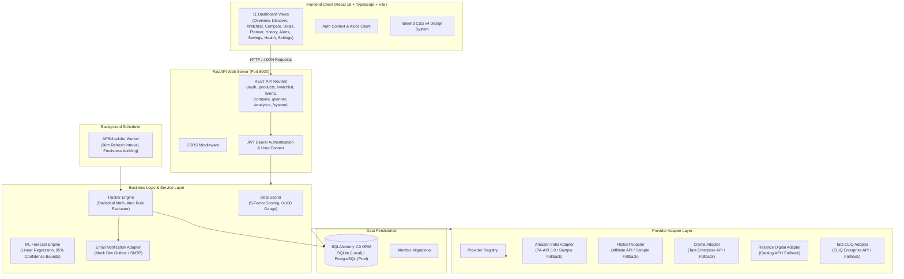

# SmartCart Intelligence: Automated E-Commerce Price Monitoring, Comparison & Shopping Intelligence Platform

[](https://github.com/raguramrrp/90-days-90-projects-day-08-smartcart-intelligence)
[](https://fastapi.tiangolo.com)
[](https://react.dev)
[](https://www.typescriptlang.org)
[](https://tailwindcss.com)
[](https://www.sqlalchemy.org)
[](https://pytest.org)
[](LICENSE)

> **SmartCart Intelligence** is an enterprise-grade full-stack web application designed for the Indian e-commerce landscape. It unifies multi-retailer price tracking, chronological price history, explainable 0–100 deal intelligence, cross-store comparison, monthly category budgeting, consumable replenishment cycles, predictive ML trend forecasting, and verified purchase savings analytics.

---

## 📌 Project Overview

- **Project Title:** SmartCart Intelligence: Automated E-Commerce Price Monitoring & Shopping Intelligence Platform
- **Challenge Series:** Day 8 of 90 Days – 90 Projects
- **Developer:** Final-Year B.Tech AI & Data Science Student
- **Target Domain:** E-commerce, Data Analytics, Web Automation & Applied Machine Learning
- **Core Focus:** India-First Retailers (Amazon India, Flipkart, Croma, Reliance Digital, Tata CLiQ)

---

## 🌟 Core Pillars & Capabilities

### 1. 🔍 Personal Price Tracker
- **Multi-Retailer Tracking:** Track individual products across Amazon India, Flipkart, Croma, Reliance Digital, and Tata CLiQ.
- **Customizable Target Prices:** Set custom target thresholds and watch your price progress meter fill up as market prices drop.
- **Threshold Alert Engine:** Configure rules for `TARGET_MET`, `PRICE_DROP`, `PERCENTAGE_DROP`, and `BACK_IN_STOCK`.
- **In-App & Email Alerts:** Receive notifications inside the app and inspect rendered transactional HTML emails via the built-in development Mock Email Outbox.

### 2. ⚡ Smart Shopping Assistant
- **Cross-Retailer Matrix:** Side-by-side breakdown of base prices, delivery fees, total checkout costs, and in-stock statuses.
- **Explainable 0–100 Deal Scorer:** Transparent 5-factor scoring model that awards points for historical average proximity (35 pts), all-time low proximity (25 pts), competitor price spread (20 pts), MRP discount depth (10 pts), and stock freshness (10 pts).
- **Objective Buying Guidance:** Clear labels (*BUY NOW*, *GOOD DEAL*, *COMPARE FIRST*, *WAIT*, or *INSUFFICIENT DATA*) backed by evidence.

### 3. 📊 Everyday Purchase Intelligence
- **Category Budget Planner:** Set monthly expenditure limits per category (Electronics, Groceries, Books, etc.) with real-time percentage progress meters.
- **Consumable Replenishment Cycles:** Track recurring purchases (tea, rice, coffee) with customized intervals (e.g., 30 days) and automated restock countdowns.
- **Verified Purchase Logger:** Record actual invoices post-purchase to compute genuine **Realized Savings** against both retail MRP and historical maximum prices.

### 4. 📈 Predictive ML Price Forecasting
- **Linear Trend Regression:** Non-black-box Ordinary Least Squares (OLS) slope analysis estimating 7-day, 14-day, and 30-day forward price trajectories.
- **95% Confidence Bounds:** Bounded by rolling residual standard errors to prevent misleading projections.
- **Cold-Start Guard:** Automatically flags `"INSUFFICIENT_HISTORY"` if fewer than 5 observations exist.

### 5. 🛡️ Immutable Data Provenance Policy
Zero fabricated numbers or fake "70% OFF" tags. Every price data point carries an auditable badge:
- `LIVE`: Verified live observation via commercial API.
- `CACHED`: Stored observation within the 60-minute freshness TTL.
- `HISTORICAL`: Previous price observation older than 24 hours.
- `SAMPLE`: Realistic Indian market seed data for local development.
- `UNAVAILABLE`: Retailer out of stock or credential missing.

---

## 🏗️ System Architecture



---

## 💻 Tech Stack

| Layer | Technologies |
| :--- | :--- |
| **Frontend** | React 19, TypeScript 5.8, Vite 8.3, Tailwind CSS v4, Lucide React, Recharts |
| **Backend** | Python 3.10+, FastAPI 0.115+, Uvicorn, Pydantic v2 |
| **Database & ORM** | SQLAlchemy 2.0, Alembic (Migrations), SQLite (default local) / PostgreSQL (production) |
| **Authentication** | PBKDF2-HMAC-SHA256 (100k rounds) password hashing, Stateless JWT (PyJWT) |
| **Background Processing** | APScheduler (In-process background price check worker) |
| **Testing** | Pytest 9.1, HTTPX, AnyIO, TypeScript Compiler (`tsc -b`), Vite Bundle Analyzer |

---

## 🖥️ The 11 Dashboard Screens

| # | Screen | Description |
| :-: | :--- | :--- |
| 1 | **Overview** | Executive KPI cards, deal of the day highlight, live retailer feed status indicators. |
| 2 | **Discover Products** | Searchable catalog with category filtering, specifications, and one-click "Track Price". |
| 3 | **My Watchlist** | Personal tracked products with target price progress meters and direct retailer links. |
| 4 | **Compare Prices** | Multi-store comparison matrix (Amazon, Flipkart, Croma, Reliance, Tata CLiQ) with shipping fees. |
| 5 | **Deal Intelligence** | 0–100 gauge score with 5-factor point breakdown and actionable buying guidance. |
| 6 | **Shopping Planner** | Custom checklists, monthly category budget warning bars, and recurring replenishment cycles. |
| 7 | **Price History** | Recharts 90-day time-series with 30d avg and all-time low, plus 7–30d ML price forecast. |
| 8 | **Alerts & Notifications** | Alert rules manager, manual price scan trigger, in-app notification inbox, and rendered HTML email outbox modal. |
| 9 | **Savings Analytics** | Potential vs. realized savings counter, verified purchase logger, and historical transactions table. |
| 10 | **Data Sources & Health** | Retailer integration latencies, commercial API prerequisites, and refresh job audit logs. |
| 11 | **Account Settings** | User profile, display currency (`INR`, `USD`, `EUR`, `GBP`), notification toggles, and commercial API key setup. |

---

## 🚀 Quickstart Guide (Windows)

### Prerequisites
- Python 3.10+ installed and on system `PATH`
- Node.js 18+ and `npm` installed and on system `PATH`

### Step 1: One-Click Automated Setup
Clone or navigate to the project directory and run:
```cmd
setup.bat
```
This script automatically sets up the Python virtual environment (`.venv`), installs all backend dependencies, generates `.env`, executes Alembic migrations, seeds Indian market catalog data, and installs frontend npm packages.

### Step 2: Launch Platform
Start both the backend server and frontend development server simultaneously:
```cmd
run.bat
```

- **Frontend Application:** `http://localhost:5173`
- **FastAPI Interactive Swagger Docs:** `http://127.0.0.1:8000/docs`
- **Health Check Endpoint:** `http://127.0.0.1:8000/health`

### Step 3: Login with Pre-loaded Demo Account
- **Email:** `demo@smartcart.ai`
- **Password:** `SmartCart123!`
*(Or click the "Fill Demo Account" button on the sign-in modal)*

---

## 🧪 Automated Testing Suite

SmartCart Intelligence includes a comprehensive test suite covering authentication, product catalog, deal scoring algorithms, alert rules, and shopping budgets:

```cmd
test.bat
```

### Pytest Execution Summary:
```text
backend/tests/test_auth.py::test_user_registration PASSED                [  5%]
backend/tests/test_auth.py::test_duplicate_email_registration_fails PASSED [ 10%]
backend/tests/test_auth.py::test_user_login_success PASSED               [ 15%]
backend/tests/test_auth.py::test_user_login_invalid_password PASSED      [ 21%]
backend/tests/test_auth.py::test_get_profile_authenticated PASSED        [ 26%]
backend/tests/test_auth.py::test_get_profile_unauthorized PASSED         [ 31%]
backend/tests/test_deal_scoring.py::test_deal_score_insufficient_data PASSED [ 36%]
backend/tests/test_deal_scoring.py::test_deal_score_excellent_deal PASSED [ 42%]
backend/tests/test_deal_scoring.py::test_deal_score_compare_first_guidance PASSED [ 47%]
backend/tests/test_deal_scoring.py::test_deal_score_out_of_stock_triggers_wait PASSED [ 52%]
backend/tests/test_planner.py::test_shopping_list_workflow PASSED        [ 57%]
backend/tests/test_planner.py::test_budget_planning PASSED               [ 63%]
backend/tests/test_planner.py::test_recurring_replenishment PASSED       [ 68%]
backend/tests/test_planner.py::test_purchase_record_and_realized_savings PASSED [ 73%]
backend/tests/test_products.py::test_get_products_list PASSED            [ 78%]
backend/tests/test_products.py::test_filter_products_by_category PASSED  [ 84%]
backend/tests/test_products.py::test_product_detail_and_stats PASSED     [ 89%]
backend/tests/test_tracker_and_alerts.py::test_add_and_remove_watchlist_item PASSED [ 94%]
backend/tests/test_tracker_and_alerts.py::test_alert_rule_evaluation_and_mock_email PASSED [100%]

======================= 19 passed, 17 warnings in 0.77s =======================
Frontend TypeScript Typecheck & Production Build: ✓ built in 737ms
```

---

## ⚖️ Legal & Ethical Compliance Policy

SmartCart Intelligence is built strictly within legal and ethical boundaries:
- **No Unauthorized Scraping:** The platform does not scrape consumer-facing web pages, bypass CAPTCHAs, or violate retailer Terms of Service.
- **Provider Adapter Architecture:** Integrations interact via official affiliate or product APIs (Amazon PA-API 5.0, Flipkart Affiliate API).
- **Certified Sample Fallback:** In development environments where commercial partner approval is pending, adapters fall back to certified sample feeds clearly labeled with the `SAMPLE` badge.
- **Attribution & Affiliate Disclosure:** Clear retailer attribution and direct product links are provided throughout the user interface.

---

## 📂 Project Directory Structure

```text
90-days-90-projects-day-08-smartcart-intelligence/
├── backend/
│   ├── alembic/                 # Database migration scripts
│   ├── app/
│   │   ├── api/                 # REST API route handlers
│   │   ├── models/              # SQLAlchemy 2.0 ORM models
│   │   ├── providers/           # India-first retailer adapter layer
│   │   ├── schemas/             # Pydantic v2 validation models
│   │   ├── services/            # Core business logic (scoring, forecast, auth)
│   │   ├── config.py            # Environment settings
│   │   ├── database.py          # SQLAlchemy engine & session maker
│   │   ├── main.py              # FastAPI application entrypoint
│   │   └── seed_data.py         # Seed data script
│   ├── tests/                   # Pytest test suite (19 tests)
│   ├── alembic.ini              # Alembic configuration
│   └── requirements.txt         # Python dependencies
├── frontend/
│   ├── src/
│   │   ├── components/          # Reusable UI components & modals
│   │   ├── context/             # React Auth context
│   │   ├── types/               # TypeScript domain interfaces
│   │   ├── views/               # 11 dashboard view components
│   │   ├── App.tsx              # Application shell & navigation router
│   │   ├── index.css            # Tailwind CSS v4 directives
│   │   └── main.tsx             # React entrypoint
│   ├── package.json             # Frontend dependencies
│   ├── tsconfig.json            # TypeScript configuration
│   └── vite.config.ts           # Vite + Tailwind build configuration
├── docs/
│   ├── ARCHITECTURE.md          # Detailed system architecture & schemas
│   ├── DEVELOPMENT_NOTES.md     # Mathematical formulations & trade-offs
│   ├── PROJECT_OVERVIEW.md      # Problem statement & market context
│   ├── TESTING.md               # Complete test matrix & execution reports
│   └── TROUBLESHOOTING.md       # Windows setup & troubleshooting FAQ
├── .env.example                 # Environment variable template
├── .gitignore                   # Git exclusion rules
├── DEMO_SCRIPT.md               # 2-minute demonstration walkthrough
├── LICENSE                      # MIT License
├── QUICKSTART.md                # 2-minute quickstart guide
├── README.md                    # Primary documentation (this file)
├── run.bat                      # Windows launcher for backend & frontend
├── setup.bat                    # Automated Windows environment setup
└── test.bat                     # Automated test runner
```

---

## 📜 License

This project is licensed under the MIT License — see the [LICENSE](LICENSE) file for details.
