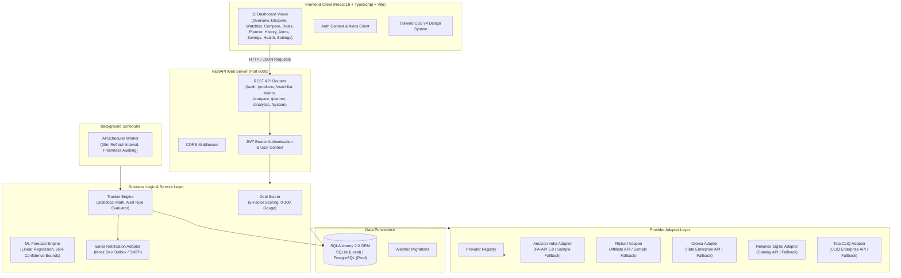
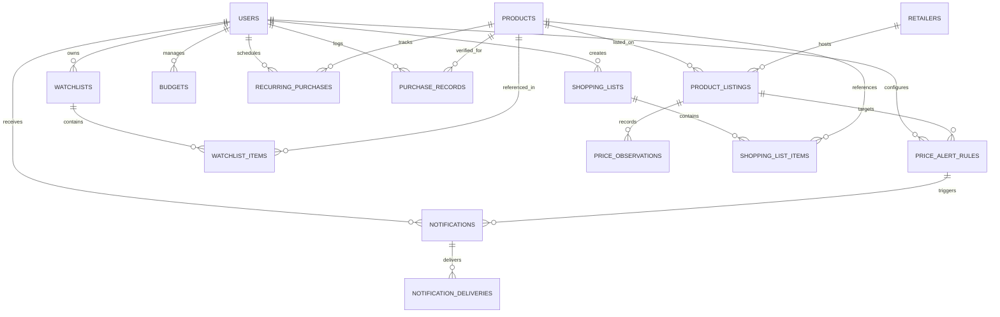

# SmartCart Intelligence — System Architecture & Design

## 1. High-Level Architecture Overview

SmartCart Intelligence is built using a clean, decoupled client-server architecture with a clear separation of concerns between presentation, business logic, asynchronous background tasks, and data persistence.



---

## 2. Relational Database Schema & Entity Relationships

The data model is managed via SQLAlchemy 2.0 and Alembic. It guarantees strict relational integrity, foreign key cascades, and user-level data isolation.



### Core Database Tables

1. **`users`**: Secure account credentials (PBKDF2-HMAC-SHA256), email, name, role (`USER`, `ADMIN`), active status.
2. **`retailers`**: Metadata for supported stores (`amazon_in`, `flipkart`, `croma`, `reliance_digital`, `tatacliq`), including homepage URLs, support status, and official logo paths.
3. **`products`**: Normalized product entity containing title, brand, model, SKU, GTIN/EAN, category, specifications, variant tags, and image URLs.
4. **`product_listings`**: Retailer-specific listing associating a product with a retailer. Stores retailer SKU, listing URL, current price, MRP, shipping fee, in-stock flag, and latest provenance badge.
5. **`price_observations`**: Chronological, immutable time-series price data point capturing base price, shipping fee, stock status, provenance badge, and observation timestamp.
6. **`watchlists` & `watchlist_items`**: User watchlists with item-specific target prices, custom notes, and priority levels.
7. **`price_alert_rules`**: User-defined trigger conditions (`PRICE_DROP`, `TARGET_MET`, `PERCENTAGE_DROP`, `BACK_IN_STOCK`) with target values, notification channels, and active toggles.
8. **`notifications` & `notification_deliveries`**: In-app alert notification records and delivery receipts (including rendered mock email HTML payload).
9. **`shopping_lists` & `shopping_list_items`**: Collaborative/personal grocery and tech shopping checklists with estimated costs and purchased checkmarks.
10. **`budgets`**: Monthly category budget targets (e.g., Electronics: ₹20,000; Groceries: ₹8,000) with dynamic spend calculation.
11. **`recurring_purchases`**: Replenishment tracking for consumables (e.g., Coffee, Tea, Rice) tracking cadence (days), last purchase date, and next expected replenishment date.
12. **`purchase_records`**: Post-purchase verified receipt logger capturing actual purchase price, retailer, invoice date, and computing realized savings vs. MRP.
13. **`refresh_jobs` & `provider_health_events`**: Audit trail for background worker runs, provider response latencies, and rate limit errors.

---

## 3. Provider Adapter Architecture & Data Provenance

To interact with Indian retailers legally and ethically without breaking terms of service or bypassing bot controls, SmartCart Intelligence uses a pluggable **Provider Adapter Pattern**.

### Adapter Hierarchy
```
ProviderAdapter (Abstract Base Class)
│
├── AmazonIndiaAdapter (amazon_in)
├── FlipkartAdapter (flipkart)
├── CromaAdapter (croma)
├── RelianceDigitalAdapter (reliance_digital)
└── TataCliqAdapter (tatacliq)
```

Each adapter implements:
- `fetch_product_price(product_id, retailer_sku)`: Fetches price details if commercial credentials are provided, or falls back to certified historical sample data with explicit `SAMPLE` provenance badges.
- `search_catalog(query, category)`: Queries retailer catalog or certified inventory.
- `get_prerequisites()`: Returns real-world registration prerequisites, required API keys, attribution guidelines, and rate limit ceilings.

### Provenance Badges
| Badge | Definition | Verification Requirement |
| :--- | :--- | :--- |
| `LIVE` | Fetched within the last 15 minutes via verified official API | Active commercial API credentials |
| `CACHED` | Verified observation stored in the database within TTL (60 mins) | Recorded DB observation |
| `HISTORICAL`| Previous price point older than 24 hours | Immutable audit log record |
| `SAMPLE` | Realistic Indian market seed data for development & demonstration | Transparently tagged in seed data |
| `UNAVAILABLE`| Retailer listing out of stock, unverified, or API unavailable | Rate limited or credential missing |

---

## 4. Deal Scoring & Guidance Engine

The **Deal Scorer** evaluates product listings on an objective, explainable 0–100 scale:

$$\text{Total Score} = S_{\text{avg}} + S_{\text{low}} + S_{\text{spread}} + S_{\text{mrp}} + S_{\text{stock}}$$

1. **Historical Average Proximity ($S_{\text{avg}}$, max 35 pts):**
   - Measures how much the current price sits below the 30-day historical moving average.
   - $> 15\%$ below average yields full 35 points. Above average yields 0 points.
2. **All-Time Low Proximity ($S_{\text{low}}$, max 25 pts):**
   - Proximity to the historical minimum price. If current price equals the all-time low, awards full 25 points.
3. **Cross-Retailer Price Spread ($S_{\text{spread}}$, max 20 pts):**
   - Evaluates whether the current retailer has the lowest price among all active competitors for the same SKU. Full 20 points if strictly cheapest.
4. **MRP Discount Depth ($S_{\text{mrp}}$, max 10 pts):**
   - Percentage discount against original retail MRP. $> 30\%$ discount awards full 10 points.
5. **Stock Availability & Freshness ($S_{\text{stock}}$, max 10 pts):**
   - In-stock status (5 pts) and data freshness within 60 minutes (5 pts).

### Actionable Guidance Matrix
- **Score $\ge 80$:** **BUY NOW** (Exceptional price dip, matches or beats all-time low).
- **Score $60 - 79$:** **GOOD DEAL** (Fair price below historical average).
- **Score $40 - 59$:** **COMPARE FIRST** (Price is near average; check competitor shipping/offers).
- **Score $< 40$ or Out-of-Stock:** **WAIT** (Price is inflated or item is unavailable).
- **$< 3$ Historical Data Points:** **INSUFFICIENT DATA** (Confidence score flagged).

---

## 5. Machine Learning Price Forecast Engine

The forecasting engine provides non-black-box price trend prediction using Ordinary Least Squares (OLS) linear trend regression combined with a rolling standard error confidence interval:

$$y_t = \alpha + \beta t + \epsilon$$

- **Forecast Trend Slope ($\beta$):** Identifies directional drift (falling, rising, or stable).
- **Confidence Bounds (95% CI):**
  $$\hat{y}_t \pm 1.96 \times \sigma_{\text{residual}}$$
- **Handling Sparse Data:** If fewer than 5 historical observations exist, the engine returns `"INSUFFICIENT_HISTORY"` to avoid misleading statistical projections.

---

## 6. Security & Multi-Tenant Data Isolation

1. **Stateless JWT Tokens:** User authentication issues signed HMAC-SHA256 tokens containing user ID and expiration claims.
2. **Row-Level User Filtering:** Every query to `/watchlist`, `/alerts`, `/planner`, and `/analytics` strictly filters by `user_id = current_user.id`.
3. **Password Security:** Passwords are never stored in plaintext. They are salted with 16 random bytes and hashed using PBKDF2-HMAC-SHA256 with 100,000 iterations.
4. **Environment Isolation:** Zero credentials or secrets in source code. All runtime options load through `.env`.
